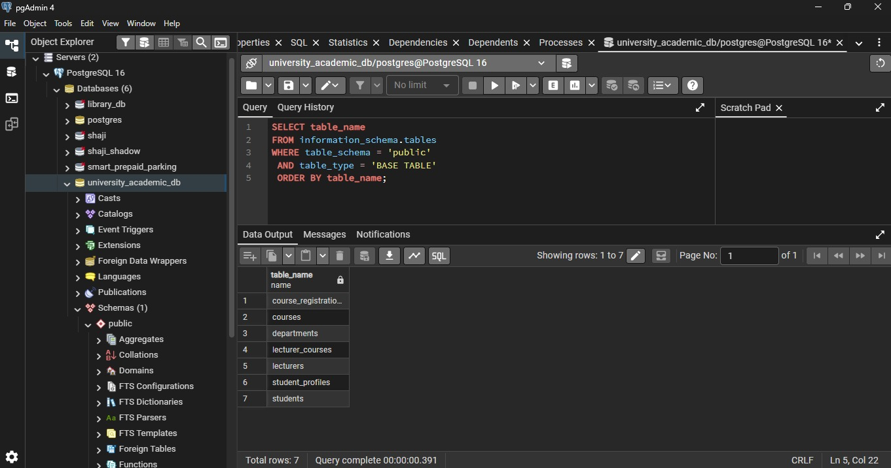

# University Course Registration and Academic Management System

**A Spring Boot and PostgreSQL academic management system focused on database modelling, entity relationships, and persistence using Spring Data JPA and Hibernate.**

**Course:** Web Technology and Internet  
**Assessment:** Individual Assignment  
**Student:** Mitchelle Anyango Anduru  
**Registration Number:** 24752

**Implementation:** Model and Repository Layers  
**Build Status:** Passed  
**Automated Tests:** 7 Passed  
**Continuous Integration:** GitHub Actions

---

## 1. Project Overview

The University Course Registration and Academic Management System is a Java-based application designed to support the structured management of university academic information.

The project addresses challenges associated with manually maintained student records, departmental information, course assignments, lecturer records, and course registrations.

Using **Spring Boot, Spring Data JPA, Hibernate, and PostgreSQL**, the application implements a relational data model that represents the university's academic structure and maintains relationships between its entities.

The implementation focuses on the **Model and Repository layers**, as specified in the assignment.

### Project Objectives

- Design a relational database for university academic management.
- Identify appropriate entities, attributes, relationships, and cardinalities.
- Implement one-to-one, one-to-many, many-to-one, and many-to-many relationships.
- Manage lecturer-course assignments using a join table.
- Represent student course registrations using a join entity.
- Implement data persistence using Spring Data JPA repositories.
- Generate and verify PostgreSQL tables using Hibernate.
- Test entity relationships and repository operations.
- Automate project verification using GitHub Actions.

---

## 2. Technology Stack

| Technology | Version / Purpose |
|---|---|
| Java | 17 |
| Spring Boot | 4.1.2 |
| Spring Data JPA | Repository and persistence operations |
| Hibernate ORM | Entity mapping and database schema generation |
| PostgreSQL | Relational database |
| Maven | Dependency management and build automation |
| JUnit 5 | Automated testing |
| VS Code | Development environment |
| Git and GitHub | Version control and collaboration workflow |
| GitHub Actions | Continuous integration |

---

## 3. Project Scope

The assignment requires implementation of two application layers.

### Model Layer

The Model layer contains Java classes representing academic entities, their attributes, relationships, and persistence constraints.

It uses Jakarta Persistence annotations including:

- `@Entity`
- `@Table`
- `@Id`
- `@GeneratedValue`
- `@OneToOne`
- `@OneToMany`
- `@ManyToOne`
- `@ManyToMany`
- `@JoinColumn`
- `@JoinTable`

### Repository Layer

The Repository layer uses Spring Data JPA interfaces extending `JpaRepository`.

It supports database persistence operations, entity retrieval, and derived queries based on academic relationships.

**Scope boundary:** The current assignment does not implement REST controllers, service classes, authentication, a frontend, or an end-user registration interface.

---

## 4. System Entities

The system contains six JPA entities.

| Entity | Description |
|---|---|
| Department | Represents an academic department and its designated head lecturer |
| Student | Represents a university student assigned to a department |
| StudentProfile | Stores personal details associated with a student |
| Lecturer | Represents teaching staff employed by departments |
| Course | Represents an academic course offered by a department |
| CourseRegistration | Records student enrolment in courses and associated academic information |

An additional `RegistrationStatus` enum represents the permitted registration states:

- `PENDING`
- `APPROVED`
- `REJECTED`

### 4.1 Course Registration Attributes

Each registration contains:

| Attribute | Description |
|---|---|
| Registration date | Date the registration was recorded |
| Academic year | Academic period, such as 2026/2027 |
| Semester | Semester of registration |
| Status | PENDING, APPROVED, or REJECTED |
| Grade | Student's grade, nullable before assessment |

---

## 5. Entity Relationships

The application implements the following relationships.

| Relationship | Cardinality | Implementation |
|---|---|---|
| Department–Student | One-to-Many | `@OneToMany` / `@ManyToOne` |
| Department–Lecturer | One-to-Many | `@OneToMany` / `@ManyToOne` |
| Department–Course | One-to-Many | `@OneToMany` / `@ManyToOne` |
| Student–StudentProfile | One-to-One | `@OneToOne` |
| Department–Head Lecturer | One-to-One reference | `@OneToOne` |
| Lecturer–Course | Many-to-Many | `@ManyToMany` / `@JoinTable` |
| Student–CourseRegistration | One-to-Many | `@OneToMany` / `@ManyToOne` |
| Course–CourseRegistration | One-to-Many | `@OneToMany` / `@ManyToOne` |

### Lecturer–Course Relationship

Lecturers can teach multiple courses, while individual courses can be assigned to multiple lecturers.

This relationship uses the `lecturer_courses` join table containing:

- `lecturer_id`
- `course_id`

The two columns form a composite primary key.

The relationship is implemented using `@ManyToMany` and `@JoinTable`, **without creating an additional Java entity**.

### Student–Course Relationship

A student can register for multiple courses, and a course can have multiple registered students.

Because each registration contains additional academic information, the relationship is implemented through the `CourseRegistration` entity rather than a simple many-to-many association.

### Department Head Relationship

Each department can designate a lecturer as its head.

The Java model checks that a lecturer belongs to the relevant department before being assigned as its head through `setHeadLecturer()`.

The implementation supports a temporary null head reference during initial department creation to accommodate the circular relationship between departments and lecturers.

---

## 6. Entity Relationship Diagram

The ERD illustrates the system's entities, attributes, primary keys, foreign keys, and relationship cardinalities.

**[View the complete Entity Relationship Diagram](docs/erd.md)**

The ERD is maintained in Mermaid format, allowing it to be reviewed and edited alongside the source code.

---

## 7. Relational Database Schema

**Database name:** `university_academic_db`

Hibernate generates seven PostgreSQL tables.

| Table | Purpose |
|---|---|
| `departments` | Department information and head lecturer |
| `students` | Student identification and departmental membership |
| `student_profiles` | Personal student information |
| `lecturers` | Academic teaching staff |
| `courses` | Academic courses |
| `course_registrations` | Registration records and academic details |
| `lecturer_courses` | Lecturer-course many-to-many join table |

The database schema includes:

- Seven primary keys.
- Nine foreign keys.
- Uniqueness constraints on selected academic identifiers.
- A unique constraint for student profiles.
- A composite primary key on `lecturer_courses`.
- A composite unique constraint for course registrations.
- A CHECK constraint for registration status values.

### Duplicate Registration Prevention

The following combination must be unique:

```sql
UNIQUE (
    student_id,
    course_id,
    academic_year,
    semester
)
```

This prevents a student from registering for the same course more than once during the same academic year and semester.

**[View the complete relational database schema](docs/database-schema.md)**

---

## 8. Project Structure

```text
university-academic-system/
│
├── .github/
│   └── workflows/
│       └── ci.yml
│
├── backend/
│   ├── src/
│   │   ├── main/
│   │   │   ├── java/com/university/academic/
│   │   │   │   ├── model/
│   │   │   │   ├── repository/
│   │   │   │   └── BackendApplication.java
│   │   │   └── resources/
│   │   │       └── application.properties
│   │   └── test/
│   │       └── java/com/university/academic/
│   ├── pom.xml
│   ├── mvnw
│   └── mvnw.cmd
│
├── docs/
│   ├── requirements-analysis.md
│   ├── erd.md
│   ├── database-schema.md
│   └── screenshots/
│
├── .gitignore
└── README.md
```

### Model Package

`backend/src/main/java/com/university/academic/model/`

Contains the six entities and `RegistrationStatus` enum.

### Repository Package

`backend/src/main/java/com/university/academic/repository/`

Contains:

- `DepartmentRepository`
- `StudentRepository`
- `StudentProfileRepository`
- `LecturerRepository`
- `CourseRepository`
- `CourseRegistrationRepository`

Each repository extends `JpaRepository` and includes relevant derived query methods.

---

## 9. Local Development Setup

### Prerequisites

Ensure the following are installed:

- Java JDK 17 or later
- Apache Maven
- PostgreSQL
- pgAdmin 4 or another PostgreSQL administration tool
- Git
- Visual Studio Code or another Java-compatible IDE

### Step 1 — Clone the Repository

```bash
git clone https://github.com/iamanduru/university-course-registration-system.git

cd university-course-registration-system/backend
```

### Step 2 — Create the PostgreSQL Database

Using pgAdmin, create a database named:

```text
university_academic_db
```

The local application configuration uses PostgreSQL on port `5432`.

### Step 3 — Configure Database Credentials

The application reads its database credentials from environment variables.

In Windows PowerShell:

```powershell
$env:DB_USERNAME = "postgres"
$env:DB_PASSWORD = [System.Net.NetworkCredential]::new(
    "",
    (Read-Host -AsSecureString "PostgreSQL password")
).Password
```

Use the PostgreSQL username configured for your environment.

The password is entered securely and is not stored in the repository.

The application uses the following Spring Boot configuration:

```properties
spring.datasource.url=jdbc:postgresql://localhost:5432/university_academic_db
spring.datasource.username=${DB_USERNAME:postgres}
spring.datasource.password=${DB_PASSWORD}
spring.datasource.driver-class-name=org.postgresql.Driver
```

Environment variables must be available in the terminal session used to start the application.

### Step 4 — Compile the Application

From the `backend` directory:

```bash
mvn clean compile
```

Expected outcome:

```text
BUILD SUCCESS
```

### Step 5 — Start Spring Boot

```bash
mvn spring-boot:run
```

During local development, Hibernate is configured with:

```properties
spring.jpa.hibernate.ddl-auto=update
```

This allows Hibernate to create or update the required database tables based on the JPA entity mappings.

A successful startup initializes the PostgreSQL connection pool, Hibernate, JPA EntityManagerFactory, and six repositories.

Because this assignment does not include a web interface or continuously running application component, Spring Boot may start and exit normally.

**Note:** Hibernate's `update` mode is used for local development and assignment demonstration. It is not intended as a production database migration strategy.

---

## 10. Automated Testing

The project includes seven automated tests.

| Test | Purpose |
|---|---|
| BackendApplicationTests | Verifies Spring Boot application context initialization |
| DepartmentRepositoryIntegrationTest | Tests department persistence and retrieval |
| StudentProfileRepositoryIntegrationTest | Tests the one-to-one student-profile relationship |
| LecturerCourseRepositoryIntegrationTest | Tests the many-to-many lecturer-course association |
| CourseRegistrationRepositoryIntegrationTest | Tests course registration persistence and queries |
| DuplicateRegistrationIntegrationTest | Verifies duplicate registration rejection |
| DepartmentHeadIntegrationTest | Tests valid department-head assignment and rejection of cross-department assignments through the model |

### Running the Tests

From the `backend` directory:

```bash
mvn clean test
```

The local integration tests use the configured PostgreSQL database.

The test cases use transactional rollback so their test records are not permanently retained.

The integration tests also use Hibernate schema validation to check the existing database mappings.

### Verified Local Results

```text
Tests run: 7, Failures: 0, Errors: 0, Skipped: 0

BUILD SUCCESS
```

All seven tests passed successfully during local verification.

---

## 11. Continuous Integration

The project uses **GitHub Actions** to automate compilation and testing.

Workflow file:

`.github/workflows/ci.yml`

The workflow runs on:

- Pushes to `main` and configured development branches.
- Pull requests targeting `main`.

### CI Pipeline

The workflow:

1. Checks out the repository.
2. Configures Java 17 using Eclipse Temurin.
3. Starts a temporary PostgreSQL 18 service.
4. Generates the Hibernate database schema.
5. Runs the Maven verification lifecycle.
6. Reports the final build and test results.

### CI Verification

The workflow has been executed successfully on GitHub.

The CI environment uses a temporary PostgreSQL instance with test-only credentials. It does not require access to the developer's local PostgreSQL database.

**[View GitHub Actions workflows](https://github.com/iamanduru/university-course-registration-system/actions)**

---

## 12. Verification Evidence

Screenshots of the database, application startup, automated tests, and CI pipeline are available in the repository.

| Evidence | Description |
|---|---|
| [01 — Database Tables](docs/screenshots/01-database-tables.png) | Seven Hibernate-generated PostgreSQL tables |
| [02 — Foreign Key Relationships](docs/screenshots/02-foreign-key-relationships.png) | Nine verified foreign key relationships |
| [03 — Database Constraints](docs/screenshots/03-database-constraints.png) | Primary keys, unique constraints, and registration status check |
| [04 — Hibernate Startup](docs/screenshots/04-hibernate-startup.png) | Successful Spring Boot and Hibernate initialization |
| [05 — Repository Tests](docs/screenshots/05-repository-tests.png) | Seven automated tests passed |
| [06 — GitHub Actions CI](docs/screenshots/06-github-actions-ci.png) | Successful GitHub Actions execution |

### Database Table Generation



### Foreign Key Verification


### Automated Test Results


---

## 13. Design Decisions and Known Limitations

### Entity Identity

All six JPA entities use generated `Long` primary keys.

The lecturer-course join table uses a composite primary key instead of an additional generated identifier.

### Student Profile Integrity

The database uses a unique, non-null foreign key to prevent multiple profiles from being associated with the same student.

The Java model provides `Student.setProfile()` to manage the association.

However, the current database schema does not independently enforce the existence of a profile for every saved student.

### Department Head Integrity

The Java model verifies department membership when assigning a head lecturer through `setHeadLecturer()`.

The database permits a temporarily null head reference during department initialization because of the circular reference between departments and lecturers.

Database-level enforcement of head membership and mandatory head completion is not implemented.

### Additional Data Validation

The schema enforces required columns, selected uniqueness constraints, foreign keys, and registration status restrictions.

Some additional business rules, such as requiring strictly positive course credits, remain outside the currently implemented database constraints.

### Application Scope

The project intentionally does not include controllers, service classes, frontend functionality, or authentication because these are outside the assignment's specified implementation scope.

---

## 14. Requirements Documentation

The full analysis and design materials are maintained separately:

- **[Requirements Analysis](docs/requirements-analysis.md)** — problem analysis, entities, attributes, relationships, cardinalities, and design decisions.
- **[Entity Relationship Diagram](docs/erd.md)** — logical ERD showing the entities and their relationships.
- **[Relational Database Schema](docs/database-schema.md)** — PostgreSQL tables, primary keys, foreign keys, constraints, and relational structure.

These documents provide the design basis for the Hibernate implementation.

---

## 15. Development and Version Control Practices

The project uses Git and GitHub for source control.

Development practices include:

- Focused feature branches.
- Descriptive Conventional Commit messages.
- Pull requests for feature integration.
- Automated CI verification.
- Source code and database design documentation.
- Exclusion of local secrets and build artifacts using `.gitignore`.

Database passwords are not committed to the repository.

---

## 16. Assignment Deliverables

| Required Deliverable | Location |
|---|---|
| Problem analysis and identified entities | `docs/requirements-analysis.md` |
| Entity Relationship Diagram | `docs/erd.md` |
| Relational database schema | `docs/database-schema.md` |
| Complete Spring Boot source code | `backend/src/main/` |
| PostgreSQL generated tables and relationships | Database implementation and evidence screenshots |
| Screenshots of mappings and table generation | `docs/screenshots/` |
| GitHub repository | Project repository |

---

## 17. Conclusion

The University Course Registration and Academic Management System demonstrates relational database modelling and persistence using Java, Spring Boot, Hibernate, Spring Data JPA, and PostgreSQL.

The implementation includes six JPA entities, six repository interfaces, seven generated PostgreSQL tables, and the required academic relationships.

Database mappings were verified through PostgreSQL inspection and automated integration testing, with all seven tests passing locally and the GitHub Actions CI workflow completing successfully.

The project provides a structured foundation for academic data management while remaining within the Model and Repository scope of the individual assignment.

---

**Web Technology and Internet — Individual Assignment**  
**Submission:** GitHub Repository Link