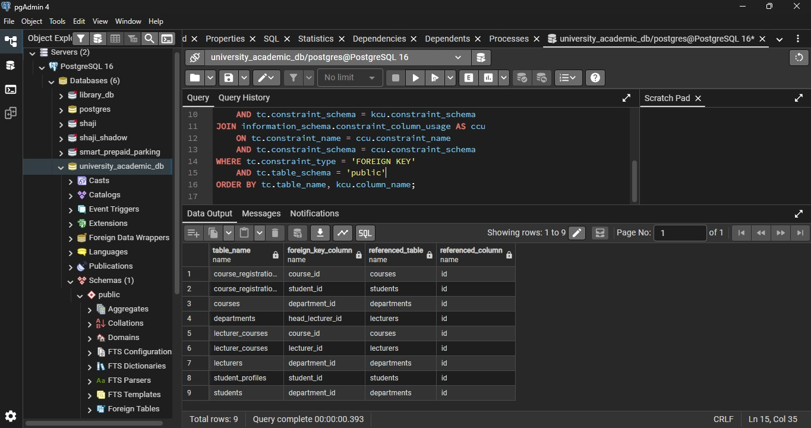
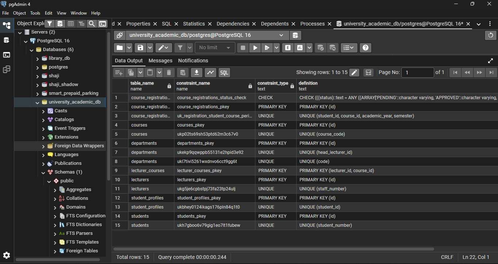
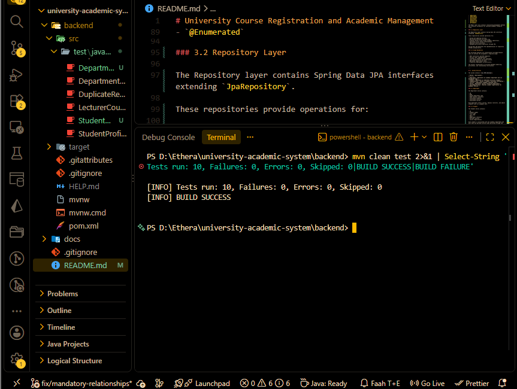
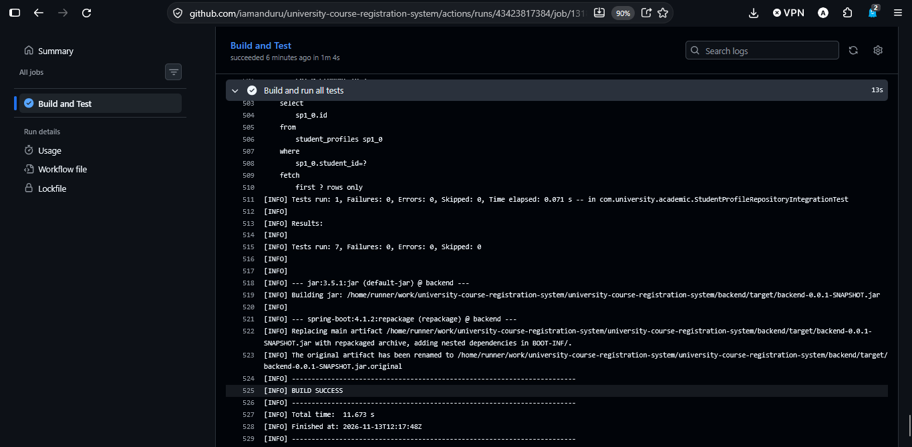

# University Course Registration and Academic Management System

**A Spring Boot and PostgreSQL academic management system implementing university entities, relationships, and data persistence using Spring Data JPA and Hibernate.**

**Course:** Web Technology and Internet  
**Assessment:** Individual Assignment  
**Student:** Mitchelle Anyango Anduru  
**Registration Number:** 24752  
**Submission Date:** 16 November 2026

**Implementation Scope:** Model and Repository Layers  
**Java Version:** 17  
**Spring Boot Version:** 4.1.2  
**Local Test Results:** 10 Tests Passed  
**Continuous Integration:** GitHub Actions

---

## 1. Project Overview

The University Course Registration and Academic Management System is a Java-based application designed to support the structured management of academic departments, students, lecturers, courses, and student course registrations.

The project addresses challenges associated with manually maintained academic records, including difficulties in managing student information, organizing departmental activities, assigning lecturers to courses, and tracking student registrations.

Using **Java, Spring Boot, Spring Data JPA, Hibernate, and PostgreSQL**, the system implements a relational database model representing the university's academic structure.

The implementation focuses specifically on the **Model and Repository layers**, as required by the Web Technology and Internet individual assignment.

### 1.1 Project Objectives

The project's objectives are to:

1. Analyze the university's academic management requirements.
2. Identify the necessary entities, attributes, and relationships.
3. Determine relationship cardinalities and appropriate database keys.
4. Design an Entity Relationship Diagram (ERD).
5. Develop a relational PostgreSQL database schema.
6. Implement JPA entities using Hibernate annotations.
7. Implement Spring Data JPA repositories.
8. Represent lecturer-course assignments using a many-to-many join table.
9. Represent student course registrations using a join entity.
10. Apply appropriate database constraints and relationship validation.
11. Verify Hibernate table generation and entity mappings.
12. Test repository operations and academic relationships.
13. Automate compilation and testing using GitHub Actions.

---

## 2. Technology Stack

| Technology | Version / Purpose |
|---|---|
| Java | JDK 17 |
| Spring Boot | 4.1.2 |
| Spring Data JPA | Database persistence and repositories |
| Hibernate ORM | Object-relational mapping and schema generation |
| PostgreSQL | Relational database management |
| Maven | Dependency management and build automation |
| JUnit 5 | Automated unit and integration testing |
| Jakarta Persistence API | Entity mapping and lifecycle callbacks |
| Visual Studio Code | Development environment |
| Git | Version control |
| GitHub | Source code repository and pull requests |
| GitHub Actions | Continuous integration |

---

## 3. Project Scope and Architecture

The assignment requires implementation of the **Model and Repository layers only**.

### 3.1 Model Layer

The Model layer represents the university's academic entities and their relationships.

It uses Jakarta Persistence annotations such as:

- `@Entity`
- `@Table`
- `@Id`
- `@GeneratedValue`
- `@Column`
- `@OneToOne`
- `@OneToMany`
- `@ManyToOne`
- `@ManyToMany`
- `@JoinColumn`
- `@JoinTable`
- `@Enumerated`
- `@PrePersist`
- `@PreUpdate`

The Model layer also contains relationship-management methods and lifecycle validation for selected academic integrity rules.

### 3.2 Repository Layer

The Repository layer contains Spring Data JPA interfaces extending `JpaRepository`.

These repositories provide operations for:

- Saving and updating entities.
- Retrieving entities by primary key.
- Finding records using unique academic identifiers.
- Searching across entity relationships.
- Checking record existence.
- Managing persistence operations through JPA.

Spring Data JPA generates the implementations of repository methods automatically.

### 3.3 Scope Boundaries

The following features are intentionally excluded because they are outside the assignment's required scope:

- REST controllers and API endpoints.
- Service layer implementation.
- Frontend or graphical user interface.
- User authentication and authorization.
- Web-based registration forms.
- Production deployment infrastructure.

The project concentrates on accurate database modelling, persistence, and relationship verification.

---

## 4. System Entities

The system contains **six JPA entities**.

| Entity | Description |
|---|---|
| Department | Represents an academic department and its designated head |
| Student | Represents an admitted university student |
| StudentProfile | Stores a student's personal information |
| Lecturer | Represents academic teaching staff |
| Course | Represents courses offered by departments |
| CourseRegistration | Records student registration for academic courses |

### 4.1 Department

The Department entity contains:

- ID
- Name
- Unique department code
- Head lecturer reference
- Associated students
- Associated lecturers
- Associated courses

Each department offers courses, employs lecturers, and admits students into its academic unit.

### 4.2 Student

The Student entity contains:

- ID
- Student number
- First name
- Last name
- Email
- Department reference
- Personal profile
- Course registrations

Each student is associated with one academic department and must have one personal profile when persisted through JPA.

### 4.3 StudentProfile

The StudentProfile entity contains:

- ID
- Date of birth
- Gender
- Phone number
- Residential address
- Student reference

Each personal profile belongs to one student through a unique foreign key.

### 4.4 Lecturer

The Lecturer entity contains:

- ID
- Staff number
- First name
- Last name
- Email
- Department reference
- Assigned courses

Lecturers may teach several courses, and eligible lecturers may be designated as department heads.

### 4.5 Course

The Course entity contains:

- ID
- Course code
- Course name
- Credits
- Department reference
- Assigned lecturers
- Course registrations

Each course belongs to one department.

### 4.6 CourseRegistration

CourseRegistration represents the registration of a student for a particular course.

It contains:

| Attribute | Description |
|---|---|
| ID | Unique registration identifier |
| Student | Student registering for the course |
| Course | Course being registered |
| Registration date | Date the registration was recorded |
| Academic year | Academic period, such as 2026/2027 |
| Semester | Semester of registration |
| Status | Registration approval status |
| Grade | Grade obtained, nullable before assessment |

### 4.7 RegistrationStatus Enum

The application defines three registration statuses:

```java
public enum RegistrationStatus {
    PENDING,
    APPROVED,
    REJECTED
}
```

The status is persisted as a string using `@Enumerated(EnumType.STRING)`.

---

## 5. Entity Relationships

The system implements eight direct JPA relationships.

| Relationship | Cardinality | JPA Implementation |
|---|---|---|
| Department–Student | One-to-Many | `@OneToMany`, `@ManyToOne` |
| Department–Lecturer | One-to-Many | `@OneToMany`, `@ManyToOne` |
| Department–Course | One-to-Many | `@OneToMany`, `@ManyToOne` |
| Student–StudentProfile | One-to-One | `@OneToOne` |
| Department–Head Lecturer | One-to-One reference | `@OneToOne` |
| Lecturer–Course | Many-to-Many | `@ManyToMany`, `@JoinTable` |
| Student–CourseRegistration | One-to-Many | `@OneToMany`, `@ManyToOne` |
| Course–CourseRegistration | One-to-Many | `@OneToMany`, `@ManyToOne` |

### 5.1 Lecturer–Course Many-to-Many Relationship

A lecturer may teach multiple courses, while a course may be taught by multiple lecturers.

This relationship is represented using the `lecturer_courses` join table.

The table contains:

- `lecturer_id`
- `course_id`

Both columns form a composite primary key.

The implementation uses `@ManyToMany` and `@JoinTable`.

**No separate LecturerCourse Java entity is created**, in accordance with the assignment requirements.

### 5.2 Student–Course Relationship

A student may register for multiple courses, and each course may have multiple registered students.

Because registration records contain additional attributes, the relationship is implemented through the `CourseRegistration` join entity.

This allows the system to store registration date, academic year, semester, status, and grade for each registration.

### 5.3 Student–StudentProfile Relationship

Each student must have exactly one personal profile.

The `student_profiles` table contains a unique, non-null `student_id` foreign key.

The Java model uses bidirectional one-to-one mapping and lifecycle validation to maintain the relationship.

### 5.4 Department–Head Lecturer Relationship

A department designates a lecturer as its head.

The department contains a `head_lecturer_id` foreign key referencing the Lecturer entity.

The relationship is represented using a unique one-to-one reference.

Department-head membership is checked through the Java model, with additional lifecycle validation for department updates.

---

## 6. Entity Relationship Diagram

The Entity Relationship Diagram illustrates:

- Academic entities and their attributes.
- Primary keys and foreign keys.
- Relationship cardinalities.
- The lecturer-course join table.
- The CourseRegistration join entity.

The diagram is maintained using Mermaid notation, making it editable and suitable for version control.

**[View the Entity Relationship Diagram](docs/erd.md)**

---

## 7. Relational Database Schema

**Database name:** `university_academic_db`

**Database management system:** PostgreSQL

Hibernate generates seven database tables:

| Table | Purpose |
|---|---|
| `departments` | Department details and designated head lecturer |
| `students` | Student information and department association |
| `student_profiles` | Personal student information |
| `lecturers` | Lecturer records and departmental membership |
| `courses` | Academic courses offered by departments |
| `course_registrations` | Student registrations and academic details |
| `lecturer_courses` | Lecturer-course teaching assignments |

### 7.1 Database Constraints

The generated schema includes:

- Seven primary keys.
- Nine foreign keys.
- Uniqueness constraints on selected academic identifiers.
- A unique student-profile association.
- A composite primary key for lecturer-course assignments.
- A composite unique constraint for student course registrations.
- A CHECK constraint for permitted registration status values.

### 7.2 Duplicate Registration Prevention

A student cannot register twice for the same course in the same academic year and semester.

This is enforced through:

```sql
UNIQUE (
    student_id,
    course_id,
    academic_year,
    semester
)
```

The database constraint prevents duplicate registrations even when registration status differs.

The behavior has been verified through a PostgreSQL integration test.

**[View the Complete Relational Database Schema](docs/database-schema.md)**

---

## 8. Data Integrity and Lifecycle Validation

The application implements database constraints and JPA lifecycle callbacks to strengthen academic data integrity.

### 8.1 Mandatory Student Profiles

The assignment requires every student to have exactly one personal profile.

The `Student` entity implements:

```java
@PrePersist
@PreUpdate
private void validateMandatoryProfile() {
    if (profile == null) {
        throw new IllegalStateException(
            "Every student must have a personal profile"
        );
    }

    if (profile.getStudent() != this) {
        throw new IllegalStateException(
            "Student profile relationship is inconsistent"
        );
    }
}
```

These callbacks check that a valid, consistently associated profile exists when a student is inserted or updated through JPA.

The database also enforces uniqueness through `student_profiles.student_id`.

**Verified behavior:**

- JPA rejects persistence of a student without a personal profile.
- A student with a correctly associated profile can be saved.
- A profile cannot be associated with multiple students through the database's unique constraint.

**Limitation:** JPA lifecycle validation does not independently protect against direct SQL operations that bypass the entity model.

### 8.2 Department Head Integrity

Each department should have a designated head lecturer belonging to that department.

The `Department` entity provides `setHeadLecturer()` to validate membership before a lecturer is assigned as the head.

The entity also implements:

- `@PrePersist` for initial department validation.
- `@PreUpdate` for mandatory head verification on department updates.

The `@PreUpdate` callback rejects updates when:

- No head lecturer has been assigned.
- The selected head lecturer does not belong to the department.

**Verified behavior:**

- A valid lecturer can be designated as head.
- Cross-department head assignment through the model setter is rejected.
- Department updates without a head are rejected through JPA.

**Initialization consideration:** A department can initially be created without a head because the department must first exist before its lecturers can be persisted.

**Limitation:** Mandatory head completion and same-department membership are not independently enforced for direct database operations. Initial creation without a head remains permitted.

### 8.3 Registration Integrity

Course registrations use:

- Mandatory student references.
- Mandatory course references.
- Academic period information.
- Enumerated registration status.
- Database uniqueness constraints.

The application allows a null grade before the student has completed the course.

---

## 9. Project Structure

```text
university-academic-system/
│
├── .github/
│   └── workflows/
│       └── ci.yml
│
├── backend/
│   ├── src/
│   │   ├── main/
│   │   │   ├── java/com/university/academic/
│   │   │   │   ├── model/
│   │   │   │   │   ├── Department.java
│   │   │   │   │   ├── Student.java
│   │   │   │   │   ├── StudentProfile.java
│   │   │   │   │   ├── Lecturer.java
│   │   │   │   │   ├── Course.java
│   │   │   │   │   ├── CourseRegistration.java
│   │   │   │   │   └── RegistrationStatus.java
│   │   │   │   │
│   │   │   │   ├── repository/
│   │   │   │   │   ├── DepartmentRepository.java
│   │   │   │   │   ├── StudentRepository.java
│   │   │   │   │   ├── StudentProfileRepository.java
│   │   │   │   │   ├── LecturerRepository.java
│   │   │   │   │   ├── CourseRepository.java
│   │   │   │   │   └── CourseRegistrationRepository.java
│   │   │   │   │
│   │   │   │   └── BackendApplication.java
│   │   │   │
│   │   │   └── resources/
│   │   │       └── application.properties
│   │   │
│   │   └── test/
│   │       └── java/com/university/academic/
│   │           ├── BackendApplicationTests.java
│   │           ├── DepartmentRepositoryIntegrationTest.java
│   │           ├── StudentProfileRepositoryIntegrationTest.java
│   │           ├── LecturerCourseRepositoryIntegrationTest.java
│   │           ├── CourseRegistrationRepositoryIntegrationTest.java
│   │           ├── DuplicateRegistrationIntegrationTest.java
│   │           ├── DepartmentHeadIntegrationTest.java
│   │           ├── StudentMandatoryProfileIntegrationTest.java
│   │           └── DepartmentHeadValidationIntegrationTest.java
│   │
│   ├── pom.xml
│   ├── mvnw
│   └── mvnw.cmd
│
├── docs/
│   ├── requirements-analysis.md
│   ├── erd.md
│   ├── database-schema.md
│   └── screenshots/
│       ├── 01-database-tables.png
│       ├── 02-foreign-key-relationships.png
│       ├── 03-database-constraints.png
│       ├── 04-hibernate-startup.png
│       ├── 05-repository-tests.png
│       └── 06-github-actions-ci.png
│
├── .gitignore
└── README.md
```

---

## 10. Local Development Setup

### 10.1 Prerequisites

The following tools are required:

- Java JDK 17 or later
- Apache Maven
- PostgreSQL
- pgAdmin 4 or another PostgreSQL administration tool
- Git
- Visual Studio Code or another Java-compatible IDE

### 10.2 Clone the Repository

```bash
git clone https://github.com/iamanduru/university-course-registration-system.git

cd university-course-registration-system/backend
```

### 10.3 Create the PostgreSQL Database

Using pgAdmin, create a database named:

```text
university_academic_db
```

The local application expects PostgreSQL to be available on port `5432`.

### 10.4 Configure Database Credentials

The application reads PostgreSQL credentials from environment variables.

In Windows PowerShell:

```powershell
$env:DB_USERNAME = "postgres"

$env:DB_PASSWORD = [System.Net.NetworkCredential]::new(
    "",
    (Read-Host -AsSecureString "PostgreSQL password")
).Password
```

Replace `postgres` with your configured database username if different.

The password is not hardcoded in the repository.

The application's datasource configuration is:

```properties
spring.datasource.url=jdbc:postgresql://localhost:5432/university_academic_db
spring.datasource.username=${DB_USERNAME:postgres}
spring.datasource.password=${DB_PASSWORD}
spring.datasource.driver-class-name=org.postgresql.Driver
```

Environment variables must be available in the same terminal session used to run the application.

### 10.5 Compile the Project

From the `backend` directory:

```bash
mvn clean compile
```

Expected output:

```text
BUILD SUCCESS
```

### 10.6 Run Spring Boot

```bash
mvn spring-boot:run
```

During local development, Hibernate uses:

```properties
spring.jpa.hibernate.ddl-auto=update
```

This allows Hibernate to generate or update the required database tables based on the JPA mappings.

Successful initialization includes:

- PostgreSQL connection pool startup.
- Hibernate ORM initialization.
- JPA EntityManagerFactory initialization.
- Discovery of six JPA repositories.
- Successful Spring Boot application startup.

Because the assignment does not include a web application layer, the application may terminate normally after startup.

**Note:** Hibernate's `update` setting is used for local development and demonstration, not as a production database migration strategy.

---

## 11. Automated Testing

The project contains **10 automated tests across nine test classes**.

The tests verify Spring Boot initialization, repository persistence, entity relationships, and selected academic integrity rules.

### 11.1 Test Coverage

| Test Class | Purpose | Tests |
|---|---|---|
| BackendApplicationTests | Verifies Spring Boot context initialization | 1 |
| DepartmentRepositoryIntegrationTest | Tests department persistence and retrieval | 1 |
| StudentProfileRepositoryIntegrationTest | Tests student-profile persistence and retrieval | 1 |
| LecturerCourseRepositoryIntegrationTest | Tests lecturer-course many-to-many assignments | 1 |
| CourseRegistrationRepositoryIntegrationTest | Tests registration persistence and derived queries | 1 |
| DuplicateRegistrationIntegrationTest | Tests duplicate registration rejection | 1 |
| DepartmentHeadIntegrationTest | Tests department-head assignment and membership | 1 |
| StudentMandatoryProfileIntegrationTest | Tests rejection of missing profiles and successful valid persistence | 2 |
| DepartmentHeadValidationIntegrationTest | Tests rejection of department updates without a head | 1 |
| **Total** | | **10** |

### 11.2 Running the Tests

From the `backend` directory:

```bash
mvn clean test
```

The integration tests use the configured PostgreSQL database.

They use transactional rollback to prevent test records from being permanently retained.

The focused JPA integration tests use Hibernate schema validation to verify compatibility with the existing database structure.

### 11.3 Verified Local Test Results

The complete test suite was executed successfully on 16 November 2026.

```text
Tests run: 10, Failures: 0, Errors: 0, Skipped: 0

BUILD SUCCESS
```

All 10 tests passed with zero failures and zero errors.

These tests verify that the implementation continues to operate correctly after the latest JPA integrity improvements.

---

## 12. Continuous Integration — GitHub Actions

The project implements continuous integration using GitHub Actions.

**Workflow:** `.github/workflows/ci.yml`

The workflow runs on configured development branch pushes and pull requests targeting `main`.

### 12.1 CI Pipeline

The workflow performs the following operations:

1. Checks out the GitHub repository.
2. Configures Java 17 using Eclipse Temurin.
3. Starts a temporary PostgreSQL 18 service.
4. Generates the Hibernate database schema.
5. Runs Maven compilation and verification.
6. Reports the results through GitHub Actions.

### 12.2 CI Environment

The GitHub Actions environment uses a temporary PostgreSQL instance with test-only credentials.

The workflow does not access the developer's personal PostgreSQL database.

No additional local test database is required.

### 12.3 CI Verification Status

The existing Java CI workflow has previously completed successfully on GitHub for the main Model and Repository implementation.

The latest mandatory-relationship improvements have passed all 10 tests locally. Their CI status will be confirmed through the final pull request before merging into `main`.

**[View GitHub Actions](https://github.com/iamanduru/university-course-registration-system/actions)**

---

## 13. Verification Evidence

Screenshots demonstrating the database structure, entity mappings, application startup, automated tests, and CI pipeline are available in `docs/screenshots/`.

| Screenshot | Evidence |
|---|---|
| [01 — Database Tables](docs/screenshots/01-database-tables.png) | Seven PostgreSQL tables generated by Hibernate |
| [02 — Foreign Key Relationships](docs/screenshots/02-foreign-key-relationships.png) | Nine verified foreign key relationships |
| [03 — Database Constraints](docs/screenshots/03-database-constraints.png) | Primary keys, unique constraints, and registration status restriction |
| [04 — Hibernate Startup](docs/screenshots/04-hibernate-startup.png) | Successful application and Hibernate initialization |
| [05 — Repository Tests](docs/screenshots/05-repository-tests.png) | Original successful seven-test suite |
| [06 — GitHub Actions CI](docs/screenshots/06-github-actions-ci.png) | Previously successful GitHub Actions workflow |

The repository's earlier test screenshot records the original seven-test suite. The latest 10-test verification is recorded in the Maven output and will be reflected in the final evidence after updating the screenshot.

### 13.1 PostgreSQL Table Generation


### 13.2 Foreign Key Relationships



### 13.3 Database Constraints



### 13.4 Repository Testing



### 13.5 GitHub Actions CI



---

## 14. Design Decisions and Known Limitations

### 14.1 Entity Identity

All six JPA entities use generated `Long` primary keys.

The lecturer-course join table uses a composite primary key consisting of its two foreign keys.

### 14.2 Student Profile Integrity

The Student entity uses `@PrePersist` and `@PreUpdate` to validate profile existence and relationship consistency during JPA insert and update operations.

The `student_profiles.student_id` foreign key is unique and non-null.

The mandatory-profile behavior is covered by two automated integration tests.

Direct SQL operations that bypass JPA are not independently covered by the lifecycle validation.

### 14.3 Department Head Integrity

A department must have a head lecturer who belongs to the department.

The Java model checks head membership during assignment.

The `@PreUpdate` callback rejects department updates without a head and checks membership consistency.

Initial creation without a head remains permitted because of the circular relationship between departments and lecturers.

The implementation does not independently enforce head completion or same-department membership for direct SQL operations.

### 14.4 Course Registration Integrity

Duplicate course registrations are prevented by a composite database unique constraint.

Registration status is restricted to:

- PENDING
- APPROVED
- REJECTED

Registration grades may remain null until assessment is complete.

### 14.5 Additional Validation

The schema enforces mandatory columns, foreign keys, and selected uniqueness constraints.

Some additional business rules, such as strictly positive course credits, are not separately enforced by database CHECK constraints in the current implementation.

### 14.6 Implementation Scope

The application does not include controllers, a service layer, user authentication, or a frontend.

This is intentional and consistent with the assignment's required scope.

---

## 15. Software Engineering Practices

The project follows structured development and verification practices.

### 15.1 Version Control

Git and GitHub are used to track changes.

Development includes:

- A stable `main` branch.
- Focused feature and fix branches.
- Descriptive Conventional Commit messages.
- Pull requests for reviewing and merging changes.

### 15.2 Continuous Integration

GitHub Actions automates compilation and testing for configured events.

Changes are verified before merging into the main branch.

### 15.3 Security Practices

- Database passwords are not hardcoded.
- Credentials are provided through environment variables.
- Build outputs and local secrets are excluded through `.gitignore`.
- Temporary CI credentials are separated from local credentials.
- Sensitive information is not required in repository documentation.

### 15.4 Documentation

The repository contains:

- Requirements analysis.
- Entity Relationship Diagram.
- Relational database schema.
- Complete Java source code.
- Automated tests.
- GitHub Actions workflow.
- Verification screenshots.
- Setup and testing instructions.

---

## 16. Assignment Deliverables

The project addresses the required deliverables as follows.

| Lecturer's Deliverable | Repository Location |
|---|---|
| Problem analysis and identified entities | `docs/requirements-analysis.md` |
| Entity Relationship Diagram | `docs/erd.md` |
| Relational database schema | `docs/database-schema.md` |
| Spring Boot source code | `backend/src/main/java/` |
| PostgreSQL generated tables and relationships | PostgreSQL implementation and verification evidence |
| Table generation and relationship screenshots | `docs/screenshots/` |
| GitHub repository link | Project repository |

### Supporting Documentation

- [Requirements Analysis](docs/requirements-analysis.md)
- [Entity Relationship Diagram](docs/erd.md)
- [Relational Database Schema](docs/database-schema.md)
- [GitHub Actions](https://github.com/iamanduru/university-course-registration-system/actions)

---

## 17. Conclusion

The University Course Registration and Academic Management System demonstrates the implementation of relational data modelling and persistence using Java, Spring Boot, Hibernate, Spring Data JPA, and PostgreSQL.

The system includes:

- Six JPA entities.
- Six Spring Data JPA repositories.
- Eight direct entity relationships.
- Seven Hibernate-generated PostgreSQL tables.
- Nine verified foreign keys.
- A lecturer-course join table.
- A CourseRegistration join entity.
- Database uniqueness and status constraints.
- JPA lifecycle validation for student profiles and department-head updates.
- Ten passing automated tests.
- A GitHub Actions continuous integration workflow.

The project provides a structured academic data model and verified persistence layer while adhering to the Model and Repository scope required by the individual assignment.

---

**Web Technology and Internet — Individual Assignment**

**Student:** Mitchelle Anyango Anduru  
**Submission Date:** 16 November 2026
