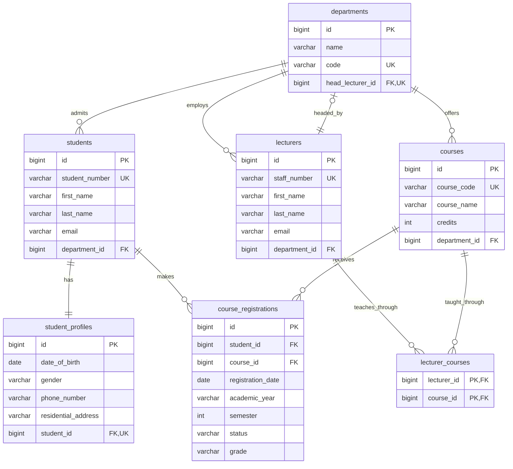

# University Course Registration and Academic Management System

## Entity Relationship Diagram (ERD)

This logical ERD represents **six JPA entities** and **one many-to-many join table**. Cardinalities reflect the assignment's domain requirements; constraints needing additional enforcement are noted below.

## Cardinality Legend

- `||` = Exactly one
- `o|` = Zero or one
- `o{` = Zero or many

## Key Design Decisions

### 1. Entity Identification

The system contains six Java entity classes:

1. Department
2. Student
3. StudentProfile
4. Lecturer
5. Course
6. CourseRegistration

Each entity will have a corresponding PostgreSQL table.

### 2. Database Tables

The database contains seven tables:

1. departments
2. students
3. student_profiles
4. lecturers
5. courses
6. course_registrations
7. lecturer_courses

The `lecturer_courses` table represents the many-to-many teaching relationship.

It will be maintained through JPA annotations without creating a separate Java entity.

### 3. Lecturer-Course Relationship

Relationship: Many-to-Many (M:N)

One lecturer can teach multiple courses.

One course can be taught by multiple lecturers.

This relationship uses a join table:

**lecturer_courses**

Primary Key:
- lecturer_id
- course_id

The combination of these two columns forms a composite primary key.

Foreign Keys:
- lecturer_id references lecturers(id)
- course_id references courses(id)

JPA annotations:
- @ManyToMany
- @JoinTable
- @JoinColumn

### 4. Student-Course Relationship

Relationship: Many-to-Many (M:N)

The relationship is implemented through the CourseRegistration join entity.

Unlike a simple join table, the join entity contains additional academic information:

- Registration date
- Academic year
- Semester
- Registration status
- Grade

Each CourseRegistration references exactly one Student and exactly one Course.

JPA annotations:
- @ManyToOne
- @JoinColumn

### 5. Student-StudentProfile Relationship

Relationship: One-to-One (1:1)

Every student must have exactly one personal profile.

Each profile belongs exclusively to one student.

The `student_profiles` table contains a `student_id` foreign key.

This foreign key must be unique and non-null.

A unique foreign key prevents multiple profiles from referencing the same student.

However, ensuring that every student has a profile requires additional enforcement during record creation or through a database integrity strategy.

JPA annotations:
- @OneToOne
- @JoinColumn

### 6. Department-Head Lecturer Relationship

Every department has one lecturer serving as its head.

The `departments` table contains:

`head_lecturer_id`

This references:

`lecturers(id)`

Our proposed design restricts a lecturer to heading at most one department.

The head lecturer must belong to the same department.

A foreign key alone cannot enforce this membership requirement.

Additional validation or database-level integrity constraints will be required.

### 7. Department Relationships

One department can have multiple:

- Students
- Lecturers
- Courses

Each Student, Lecturer, and Course belongs to exactly one Department.

These relationships are implemented using one-to-many and many-to-one mappings.

JPA annotations:
- @OneToMany
- @ManyToOne
- @JoinColumn

### 8. Registration Integrity

Each registration contains:

- student_id
- course_id
- registration_date
- academic_year
- semester
- status
- grade

The following combination should be unique:

`(student_id, course_id, academic_year, semester)`

This prevents duplicate registrations for the same course during the same academic period.

It still allows students to register for a course in a different academic year or semester.

### 9. Registration Status

The registration status is represented using a Java enum.

Permitted values:

- PENDING
- APPROVED
- REJECTED

Hibernate will persist the enum using its string representation.

JPA annotation:
- @Enumerated(EnumType.STRING)

### 10. Primary Keys

All six JPA entities use generated primary keys.

JPA annotations:
- @Id
- @GeneratedValue

The lecturer_courses join table uses a composite primary key consisting of its two foreign keys.

### 11. Circular Relationship Considerations

The Department-Lecturer relationship creates a circular reference:

- lecturers.department_id references departments.id
- departments.head_lecturer_id references lecturers.id

The implementation must account for insert sequencing and database constraints.

We will verify this during entity mapping and persistence testing.

## Conclusion

The Entity Relationship Diagram provides the logical structure for the University Course Registration and Academic Management System.

It identifies the six JPA entities, seven PostgreSQL tables, their attributes, primary keys, foreign keys, and relationship cardinalities.

The ERD will guide the implementation of Hibernate entity mappings, Spring Data JPA repositories, and database constraints.

The next stage is the preparation of the complete relational database schema.
